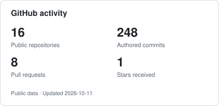
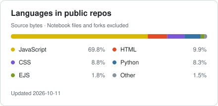

Hi, I’m Dhanunjay. I’m interested in software, AI integration, machine learning, and how systems work. I learn best by building something, running into problems, and figuring them out. This GitHub holds my projects, experiments, and the things I’ve been working to understand.

[LinkedIn](https://www.linkedin.com/in/dhanunjaypanta) · [Email](mailto:pantadhanunjay@gmail.com)

## Languages & tools

| Area | Technologies |
| :--- | :--- |
| Languages | Python, Go, C++, C, JavaScript, TypeScript |
| Web | HTML, CSS, React, Next.js, Node.js, Express, Tailwind CSS |
| Data | MongoDB, Firebase |
| Machine learning | PyTorch, scikit-learn, XGBoost |
| AI integration | Gemini & OpenAI APIs, TensorFlow.js, Google Cloud Text-to-Speech |
| Development & deployment | Git, Linux, Docker, GitHub Actions, Vercel, Render |

## GitHub stats

  <picture>
    <source media="(prefers-color-scheme: dark)" srcset="assets/github-stats-dark.svg">
    
  </picture>
  <picture>
    <source media="(prefers-color-scheme: dark)" srcset="assets/languages-dark.svg">
    
  </picture>

Public data, refreshed daily. Commits count my authorship on the default branches of my public repositories. Language share excludes forks and notebook files.
