Hi, I’m Dhanunjay. I’m interested in software, AI integration, machine learning, and how systems work. I learn best by building something, running into problems, and figuring them out. This GitHub holds my projects, experiments, and the things I’ve been working to understand.

## Languages & tools

       

       

      

     

## GitHub stats

  
  

## Connect

